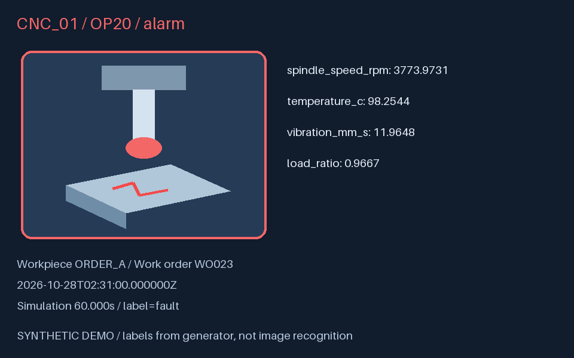

# 任务2.1：共享契约与WP1实施反馈

日期：2026-10-28（北京时间）。来源：用户正式批准Step 1第3.1—3.3节契约设计、第4节隔离边界，并限定本轮为共享契约+WP1；完成后停止，等待WP2指令。

**状态：本轮代码、专项测试、旧系统回归及GitHub代码推送已完成；未实现WP2服务。** 本轮遵守用户最新指示，没有读取或修改项目索引。无子Agent委派。

## 1. 已交付与范围

- 三个Pydantic严格契约及JSON Schema导出：RawIngestMessage固定8字段，SemanticObject恰好7字段，RelationEdge固定7字段；均extra=forbid、strict，递归拒绝非JSON值和NaN/Inf。
- 演示配置：带时区epoch、ENT_01→FAC_01→LINE_01→CNC_01层级、设备地址与ID注册、采样周期/种子/正常值、故障注入窗口、库存物料。
- 真实ERP创建订单和真实MES dispatch/assign/release包装；数据保存在独立demo_erp.sqlite3。原练习库不写入。
- 原SimPy引擎新增可选observer=None钩子；真实活动工序内按1秒采样四路信号；默认关闭时原行为保持。
- Pillow动态PNG、PNG内嵌元数据和SHA-256；非结构化设备行日志及其上下文索引。
- MQTT内存发布/订阅和实际接收记录；OPC UA命名节点写入/读取；自定义PLC二进制/十六进制帧及正常、截断、CRC错误、未知地址样例。
- 可运行入口为 `python -m task2_1_prototype.simulators.simpy_factory`。没有提前创建WP2 Connector、semantic_mapping、relation_inference、图服务、五类新网关或run_e2e_demo.py。

## 2. 修改文件清单

### 旧业务源码唯一改动

`minimal_factory/simulation/engine.py`：仅在simulate内部添加可选观察器参数、事件通知和活动工序观察器协程入口；默认timeout顺序不变。其他ERP/MES/SimPy源码、原44项测试、原业务数据库及原样本未修改。

### 新增代码、配置与说明

```text
task2_1_prototype/
├── __init__.py
├── README.md
├── requirements.txt / requirements-dev.txt
├── contracts/
│   ├── __init__.py / models.py / export_schema.py
│   ├── README.md / plc_frame.md
│   └── schemas/
│       ├── RawIngestMessage.schema.json
│       ├── SemanticObject.schema.json
│       └── RelationEdge.schema.json
├── config/
│   ├── __init__.py
│   └── demo.json
├── simulators/
│   ├── __init__.py / legacy_bridge.py
│   ├── erp_simulator.py / mes_simulator.py
│   ├── simpy_factory.py / protocol_emulator.py / visuals.py
└── tests/
    ├── test_wp1_contracts.py
    ├── test_wp1_protocols.py
    ├── test_wp1_factory.py
    └── fixtures/legacy_event_baseline.json
```

本轮另新增 `md/agent_reports/evidence/2026-10-28_wp1_tests.txt`、`2026-10-28_wp1_legacy_tests.txt`、`2026-10-28_wp1_acceptance.json`、`2026-10-28_wp1_alarm.png`，以及本报告；更新 `md/项目推进日志.md` 与 `minimal_factory/当前进度.md`。

## 3. 契约与协议的实际约定

| 项目 | 已冻结的实现 |
|---|---|
| RawIngestMessage | message_id/source_system/protocol/modality/timestamp/object_hint/raw_payload/raw_context，8字段全部必填 |
| SemanticObject | object_id/object_type/domain/level/state/context/timestamp，7字段全部必填；state/context为JSON对象 |
| RelationEdge | relation_id/source/relation/target/weight/timestamp/context，7字段；weight有限且在[0,1] |
| protocol | OPC_UA/MQTT/REST_API/POSTGRESQL/SQLITE/PLC_FRAME；SQLITE按本轮用户批准新增 |
| 对象类型 | equipment/process/work_order/order/resource；组织节点resource且context.resource_kind=organization |
| 时间 | simulation_epoch+仿真秒；UTC ISO-8601字符串，保留微秒；context另存仿真时钟、序号和原始ID |
| 业务ID | ERP/MES仍使用原UUID；注册表显式绑定演示别名。process映射键包含work_order，第二工单不会合并到OP20 |
| 状态融合边界 | fault不能被普通图片/INFO解除的约束已写文档；真正状态合并属WP3，未冒充本轮已实现 |

PLC完整帧为18字节：AA55(2B)+地址(1B)+03(1B)+08(1B)+数据(8B)+控制(1B)+心跳(2B)+CRC(2B)。rpm/温度/振动/load缩放分别为1/100/100/10000；数据和心跳大端，温度为有符号16位；CRC-16/MODBUS小端，覆盖前16字节。定点ROUND_HALF_UP。独立标准CRC向量123456789→4B37通过。

固定样例（rpm4200、温度78.5、振动4.8、load0.88、心跳42）：

```text
AA 55 01 03 08 10 68 1E AA 01 E0 22 60 01 00 2A DC 46
```

完整字节表见 [PLC协议规范](../../task2_1_prototype/contracts/plc_frame.md)。PLC时间、工单和订单不在帧内，后续接入器必须补齐采集/调度上下文。

## 4. 本轮真实运行结果与产物

实际命令（项目根目录）：

```powershell
& '.\minimal_factory\.venv\Scripts\python.exe' -B -X utf8 -m task2_1_prototype.simulators.simpy_factory --output 'task2_1_prototype/artifacts/wp1_smoke_20261028'
```

退出码0；run.json.status=completed。实际产物位于 `D:\AAA-Myproject\postgraduate\Project 2\task2_1_prototype\artifacts\wp1_smoke_20261028\`。输出目录不可覆盖，复跑应换新名称。

| 结果 | 本轮实测 |
|---|---|
| 业务流 | ERP真实POST创建1订单；MES创建1工单、3道工序并完成设备分配/下达；SimPy副本完工 |
| 仿真时长 | 6分钟，原源工单保持released，仿真副本completed |
| 四路信号 | 360条；CNC_01在[0,180)秒，QC_01在[180,300)秒，MOVE_01在[300,360)秒 |
| 故障 | CNC_01/OP20的[60,90)秒，共30条异常采样；1次ERROR告警，第90秒明确恢复 |
| PNG | 9张960×600，含开工、加工中、质量、告警、恢复节点；全部CRC/Pillow解码通过 |
| 日志 | 8条原始行日志，含时间、地址、设备、工序、工单、订单和故障码 |
| 协议记录 | REST_API 1、SQLITE 1、MQTT 400、OPC_UA 1440、PLC_FRAME 360，共2202条 |

REST通过TestClient调用真实ASGI路由，无端口监听；SQLite是真实本地数据库；MQTT为内存pub/sub Mock；OPC UA为命名节点Mock；PLC为本项目自定义仿真帧。未测试实网Broker/OPC UA服务或PostgreSQL连接。

产物包括config/input/id_registry、独立数据库、events/summary、signals.jsonl、images.jsonl、sim_images、equipment.log/device_logs.jsonl、transport_records.jsonl、mqtt_received.jsonl、plc_frames.bin和plc_frame_examples.json。运行数据库和整批产物由Git忽略；仓库保留代码、测试、验收摘要和一张报警示例。配置/版本/文件哈希见 [验收JSON](evidence/2026-10-28_wp1_acceptance.json)。



图片和信号都是合成教学数据；裂纹/报警标记来自生成配置，不是视觉识别结果或实机故障。CNC_01是独立演示中的E-ASM映射，不修改旧设备名称或类型，不声称建立CNC物理模型。

## 5. 实际验证命令、退出码与证据

### WP1专项与契约测试

```powershell
& '.\minimal_factory\.venv\Scripts\python.exe' -B -X utf8 -m unittest discover -s task2_1_prototype/tests -p 'test_wp1*.py' -v
```

**24项通过，5.529秒，退出码0**。日志：[WP1测试](evidence/2026-10-28_wp1_tests.txt)。覆盖：

- 三模型合法样本、每个必填字段缺失、额外字段、错误枚举/类型、无时区/非法日期、深层NaN/Inf；独立JSON Schema验证与导出文件一致。
- 工序/工单唯一映射、组织节点仍为五类对象中的resource。
- 完整采样落在真实[start,end)内，CNC空闲无错误绑定，故障仅影响30条指定采样。
- 相同输入快照/注册表/seed/epoch/run_id重放，signals/images/log索引、原始行日志、PLC二进制及每张PNG逐字节一致；Python全局随机源不变。两次新建ERP业务会有不同UUID和墙钟，未声称新业务所有文件逐字节相同。
- PNG签名、每个chunk CRC、IEND、Pillow verify/load、960×600和内嵌业务元数据；报警帧另进行了视觉检查。
- 实际MQTT订阅投递、Topic匹配、订阅者数据隔离，OPC节点四字段及复制读取；全部2202条源记录的测试用预期Raw封装通过契约。
- PLC固定已知字节向量、符号/定点量化、心跳序号、完整二进制文件偏移；截断、CRC、未知地址、头/长度/功能码/控制码及范围错误拒绝。
- 默认关闭观察器时，默认6/9分钟、返修12/9分钟和36/48条事件顺序与改造前提交d53fb7b的金样本完全一致。只归一化真实recorded_at、run_id与随机返修UUID，不忽略仿真时间、序号、工序、设备、数量和先后顺序。
- 301秒超长采样周期不延长9分钟makespan，两个工单的OP20/OP20_2不混淆；观察器异常导致run=failed，不输出成功summary。

### 原44项回归

原项目使用顶层erp/mes导入；从用户指定的根目录执行需临时设置PYTHONPATH，不改原测试：

```powershell
$env:PYTHONPATH = (Resolve-Path -LiteralPath '.\minimal_factory').Path
& '.\minimal_factory\.venv\Scripts\python.exe' -B -X utf8 -m unittest discover -s minimal_factory/tests -v
```

**44项通过，10.149秒，退出码0**。日志：[旧系统回归](evidence/2026-10-28_wp1_legacy_tests.txt)。日志中的“测试异常”、模拟PID123和脚本FAIL是既有测试预期的失败分支，不是当前真实服务故障。

原 `minimal_factory/data/erp.db` 本轮开始、运行后及回归后的SHA-256均为：

```text
D98A81A49CB950AC8DF38B4B164856D48295E10EDF44BE564A080048D4F0424A
```

未重启旧演示服务，也未把源工单推进成完成。`git diff --check`通过，旧业务源码差异只有simulate钩子。

### 环境与本轮修复

- 通过uv向项目原`.venv`安装Pillow13.0.0、NetworkX3.7、jsonschema4.26.0及其依赖，安装退出码0；PIL/networkx已实际导入。不需要PNG后备实现。
- 原Pydantic2.14.1、FastAPI0.143.2、SimPy4.1.1、Uvicorn0.54.0、httpx0.28.1保持。依赖写入新目录清单，没有修改旧requirements。
- 正确使用SimPy Timeout.processed判断完成，避免误用构造时已经为True的triggered；末次采样等待复用工序完成事件，杜绝越界定时器拉长env.run。
- 首次完整WP1测试出现1个清理错误：测试中的SQLite上下文管理器未关闭句柄，导致Windows临时目录删除失败。改用contextlib.closing后重跑24项全部通过；该问题属于测试资源清理，不是业务库损坏。
- Starlette/httpx弃用提醒仍存在，不影响本轮测试；未为此升级旧依赖。

## 6. Git与GitHub交付

- 代码与测试提交：**`2f52e46`**，`feat(wp1): add strict contracts and multimodal protocol simulators`。30个文件，包含代码、三份Schema、测试/金样本、README及验收证据；旧engine净变更16行新增、2行删除。
- 用户指定新建私有仓库：**[zzz22-9/postgraduat_Project2](https://github.com/zzz22-9/postgraduat_Project2)**。GitHub API已确认private=true；未设置公开。
- `origin`为`https://github.com/zzz22-9/postgraduat_Project2.git`；`git push -u origin master`已成功，代码提交已上传。
- 本报告与两份进度记录另作文档提交，避免在代码提交中自引用未知哈希；最终文档提交可用`git log -1 --oneline`查询。后续文档推送完成后以远端master与本地HEAD一致为验证依据。
- 保留原有4份未跟踪历史MD，不混入本轮提交；没有上传业务数据库、虚拟环境、凭据或全部运行目录。

## 7. 留给WP2的明确接口约束

1. 先读本报告、根目录task.md.md、`contracts/models.py`与导出Schema；不要读取项目索引。用户已批准的契约细化不需要再次征求确认。
2. 本轮`ProtocolEmitter.emit()`生成**源信封**，字段是sequence/source_system/protocol/modality/channel/timestamp/payload/context/object_hint，尚不是RawIngestMessage。WP2须自行实现接入与8字段标准封装；目前只有测试里做了预期封装校验。
3. REST可复用进程内ASGI或另启测试端口；DB读取独立demo_erp.sqlite3中的orders/inventory，不能初始化或迁移原data/erp.db。
4. MQTT接口：MemoryMqttBroker.subscribe(filter)返回队列，publish(topic,payload)复制投递；支持+/#匹配。OPC UA读取`OpcUaNodeStore.read(NodeId)`，返回NodeId/Value/StatusCode/SourceTimestamp；当前全为Mock模式。
5. PLC接口：encode_plc_frame返回bytes，decode_plc_frame接收bytes或hex字符串并验证已知地址；它只是底层编解码工具，不是已完成的OpcUaAndPlcConnector。帧外上下文必须来自注册表与调度，不得捏造帧内工单号。
6. 原始ID以id_registry.json为准；process键必须带原work_order，禁止只按工序编号合并不同实例。`raw_context`的*_id是已映射演示标识，legacy_ids保留源UUID；WP3再按标准context键归一化。
7. PNG引用相对于本轮产物目录，含SHA-256；读取时校验路径范围、文件存在与哈希。图片标签来自生成元数据，不能表述为识别模型输出。
8. 信号中的injected_fault是生成真值。后续状态规则应根据数值和日志独立判定，不直接把真值当诊断结果。INFO日志不自动清除fault；本轮恢复日志有明确state_action=fault_cleared。
9. 使用事件时间和sequence处理同刻数据，保留source/run/scenario隔离；原业务事件中的recorded_at是墙钟，不能替换标准仿真时间。
10. 本轮故障只改变观测信号/图像/日志，不暂停MES或延长排程；风险传播是WP3/WP4后续任务。NetworkX目前仅安装，没有图模型成果。

## 8. 下一步与停止点

共享契约与WP1已完成，专项及44项回归通过，代码已推送私有GitHub。按用户要求停在此处，等待WP2指令。未开发WP2—WP5、未运行完整2.1端到端脚本、未Docker化，也未将程序交付等同于用户已掌握或导师已验收。
